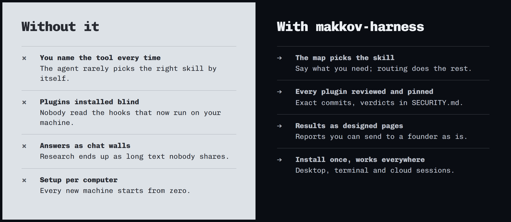
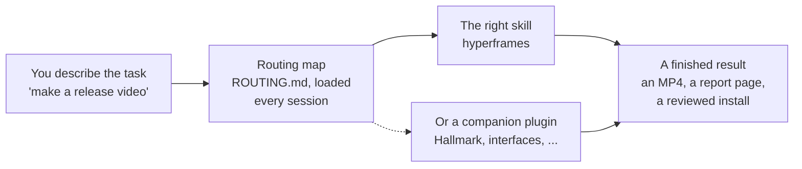
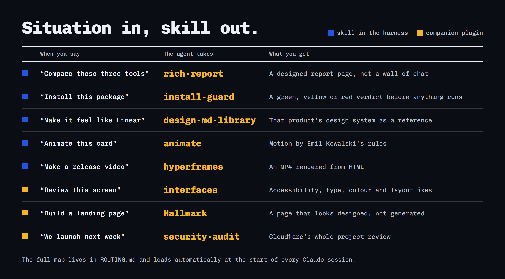
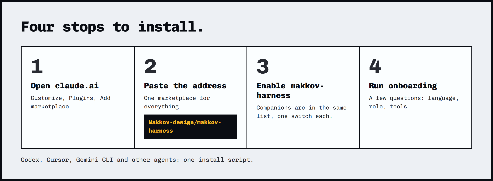
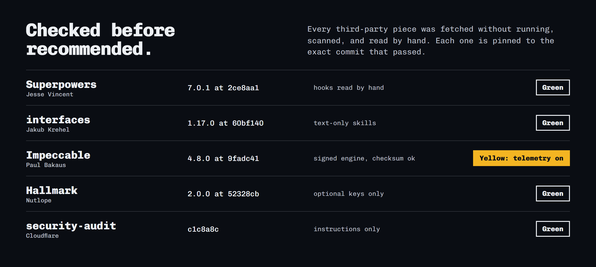

  

  
  
  
  

  <b>A designer's harness for AI agents.</b> 
  Your agent stops guessing which tool to use: a routing map picks the right skill for every situation, 
  results come back as designed pages, and every third-party plugin is security-reviewed before you get it.

  <a href="#install-in-two-minutes"><b>Install in two minutes</b></a> &nbsp;|&nbsp;
  <a href="https://makkov-design.github.io/makkov-harness/">Website</a> &nbsp;|&nbsp;
  <a href="ROUTING.md">The routing map</a> &nbsp;|&nbsp;
  <a href="SECURITY.md">Security verdicts</a>

---

## Why designers install it

AI agents already have hundreds of skills and plugins. The hard part is getting the right one to run at the right moment, without installing something you never checked. makkov-harness solves exactly that.

- **The agent picks the right skill on its own.** A routing map loads at the start of every session and tells the agent which skill fits which situation. You say "compare these three tools", it builds a report page. You say "install this package", it reviews the package first.
- **Nothing third-party reaches your machine unchecked.** Every companion plugin was fetched without running, scanned, and had its hooks and scripts read by hand. Each one is pinned to the exact commit that passed, and a weekly check flags new upstream versions for review.
- **Results you can send as they are.** Research, comparisons, plans and audits come back as designed, interactive pages with real tables, charts and navigation, not as a wall of chat text.
- **Install once, works everywhere.** Add it in the browser once and it follows your account: the desktop app, Claude Code, cloud sessions and every computer you sign in on. Codex, Cursor, Gemini CLI and five more agents get it with one script.

## How it works

No commands to memorise and no skill names to remember. The map does the matching; you keep talking about the work.

## What's inside

| Skill | What it does for you |
|---|---|
| `rich-report` | Turns research, plans and audits into a designed, interactive report page (Claude Artifacts) |
| `html-report` | The same reports as one self-contained HTML file, for every other agent |
| `third-party-install-guard` | Reviews any package, plugin, skill or MCP server for malware and risky behavior **before** it is installed, with a green, yellow or red verdict |
| `design-md-library` | "Make it in the style of Linear, Stripe or Notion": pulls that product's design-system write-up as a reference |
| `animate`, `animate-expo`, `animation-performance`, `improve-animations`, `find-animation-opportunities` | Motion done right, by Emil Kowalski |
| `hyperframes` + 5 helpers | HTML to video: promo clips, release videos, animated slides, by HeyGen |
| `harness-onboarding` | A few questions, then the harness is tuned to you: language, role, tools |
| `ROUTING.md` | The "situation → skill" map, loaded automatically in Claude and added to your instructions file elsewhere |

## Install in two minutes

**Claude (desktop app, Claude Code, cloud sessions).** In a **browser**, open claude.ai → Customize → Plugins → Add → Add marketplace → paste `Makkov-design/makkov-harness` → enable **makkov-harness**. Once is enough: it is added to your account, so it works on every computer you sign in on and in cloud sessions. (Adding it from the desktop app installs it on that one computer only. In a terminal, also this computer only: `/plugin marketplace add Makkov-design/makkov-harness`, then `/plugin install makkov-harness@makkov-harness`.)

**Easiest for any agent: give it this repository.** Paste the link and say "install this". The agent reads [`INSTALL.md`](INSTALL.md) and sets everything up for its own environment.

**Codex, Cursor, Gemini CLI, Copilot, Windsurf, Cline, OpenCode, Aider.** Clone the repository and run `install/install.ps1 -Agent <agent>` (Windows) or `install/install.sh <agent>` (macOS, Linux). Details per tool in [`INSTALL.md`](INSTALL.md) and [`COMPATIBILITY.md`](COMPATIBILITY.md).

**Chat apps** (ChatGPT, Grok, DeepSeek, Gemini in a browser): a lighter pack you paste in, see [`adapters/chat-pack`](adapters/chat-pack/README.md).

**Claude cloud sessions (claude.ai/code).** Nothing extra is required. When a session needs to render a Hyperframes video or run a Hallmark browser check and the tools are missing, the agent offers to install them (1–2 minutes, only after you say yes). If you render often, paste [`cloud/setup-design-tools.sh`](cloud/setup-design-tools.sh) into your cloud environment's Setup script and add `HYPERFRAMES_NO_TELEMETRY=1` to its variables. It installs pinned, reviewed versions of ffmpeg, puppeteer-core and the Hyperframes CLI.

**Updates.** Your account keeps the copy it took when you added the plugin. To get a newer version: claude.ai → Customize → Plugins → Manage marketplaces → `makkov-harness` → ⋯ → Sync, then fully quit and reopen the desktop app.

Then run `harness-onboarding` once, and you are set.

## Companion plugins, reviewed and pinned

The best design plugins, in one list. Their code stays in their authors' repositories; the makkov-harness marketplace lists them, pinned to the exact version that was reviewed (verdicts in [`SECURITY.md`](SECURITY.md)), so after adding the marketplace you enable each one with one switch. A newer version appears here only after it is reviewed again. If you already have one of these from its author's own marketplace, keep that one and don't enable it here too, or its skills load twice. Figma's plugin is in Anthropic's official marketplace.

| Plugin | Use it for | By |
|---|---|---|
| Superpowers | Brainstorming before building, debugging, plans | [obra/superpowers](https://github.com/obra/superpowers) |
| interfaces | UI review: accessibility, typography, color, layout, copy | [jakubkrehel/skills](https://github.com/jakubkrehel/skills) |
| Impeccable | Creative direction: bolder or quieter, onboarding, DESIGN.md | [pbakaus/impeccable](https://github.com/pbakaus/impeccable) |
| Hallmark | New landing pages and sites that look designed, not generated | [Nutlope/hallmark](https://github.com/Nutlope/hallmark) |
| security-audit | Whole-project security review before a launch | [cloudflare/security-audit-skill](https://github.com/cloudflare/security-audit-skill) |
| ytlens | Watch and analyze YouTube videos (frames and audio) through Gemini | [Makkov-design/ytlens](https://github.com/Makkov-design/ytlens) |

## Principles

- **Credit, don't repackage.** Other people's work is linked or, where the license allows and linking is impractical, copied unmodified with its license. See [`CREDITS.md`](CREDITS.md).
- **Checked before recommended.** Every third-party piece has a dated verdict in [`SECURITY.md`](SECURITY.md).
- **Nothing runs that you can't read.** The only hook reads `ROUTING.md` and prints it. Installers copy local files and download nothing.
- **No keys in files.** Ever.

## Like it? Star it and pass it on

If the harness saved you one wrong tool, one unchecked install or one wall of chat text, **[give it a star ⭐](https://github.com/Makkov-design/makkov-harness/stargazers)**. Stars are how other designers find it, and they tell me which direction to keep building.

- **Share it** with a designer friend or your team: the link [makkov-design.github.io/makkov-harness](https://makkov-design.github.io/makkov-harness/) explains it in one screen.
- **Ideas, bugs, a skill you want routed?** [Open an issue](https://github.com/Makkov-design/makkov-harness/issues). Pull requests are welcome: see [`CONTRIBUTING.md`](CONTRIBUTING.md).

---

MIT licensed. Third-party skills keep their own licenses. Not affiliated with Anthropic, OpenAI, Google, Cursor, GitHub or any other vendor named here.
