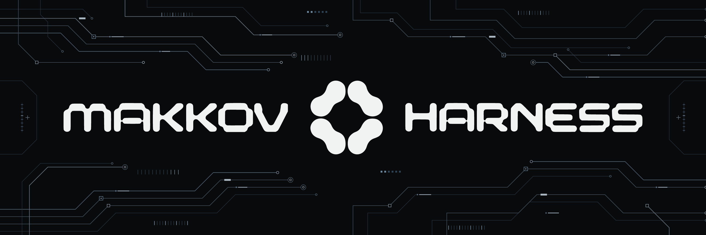
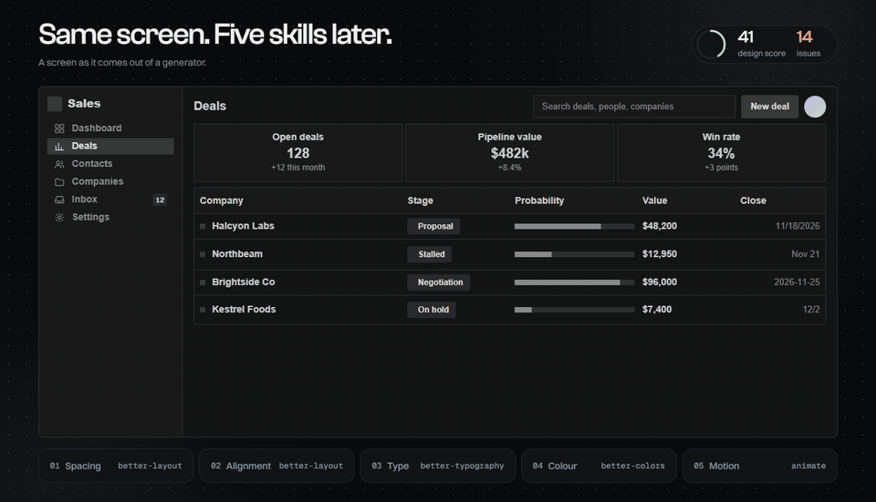
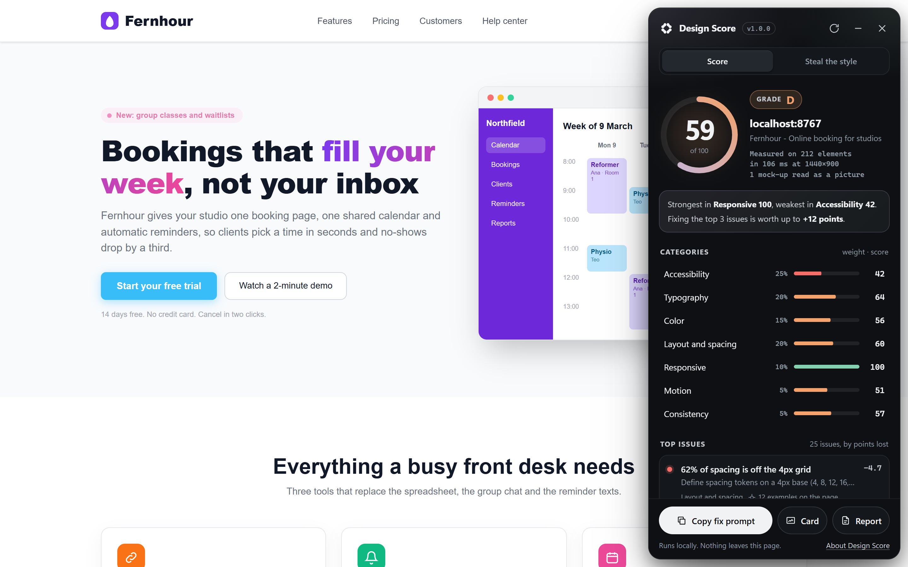
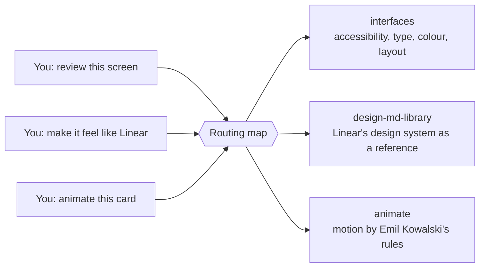
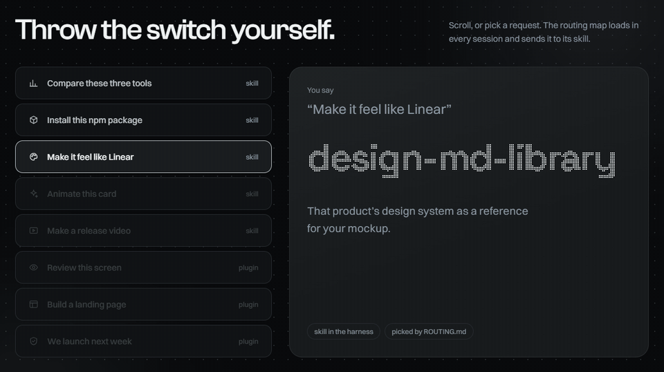
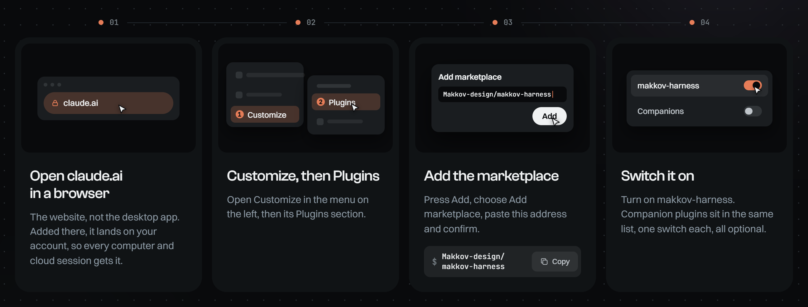
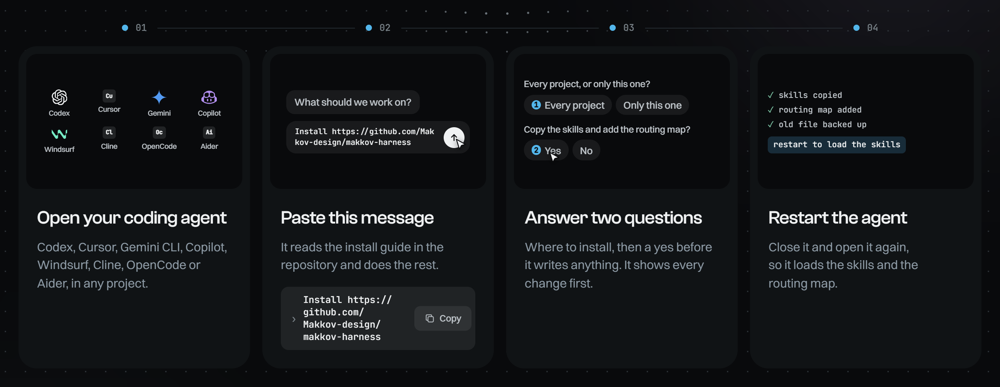
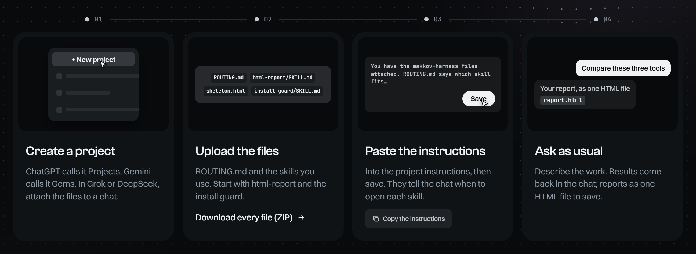
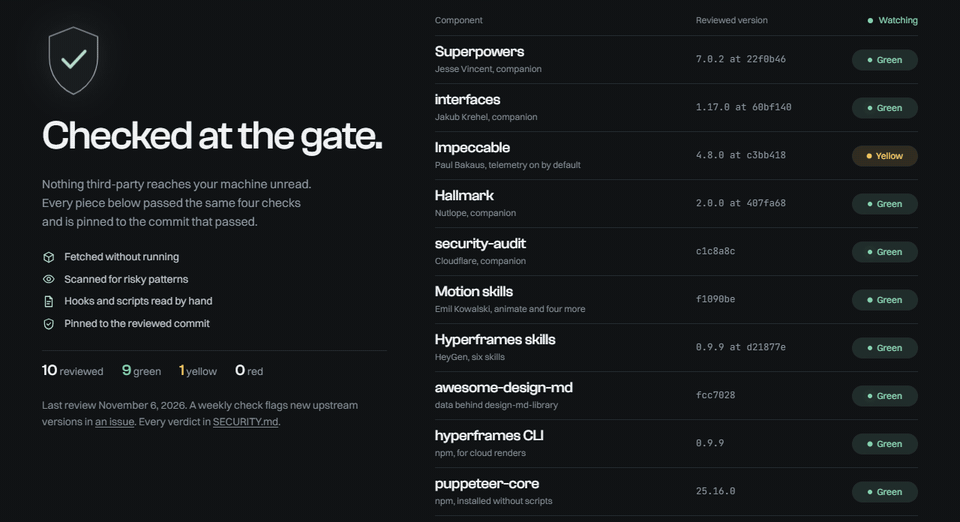

<p align="center">
  <a href="https://makkov-design.github.io/makkov-harness/"></a>
</p>

<p align="center">
  <a href="https://github.com/Makkov-design/makkov-harness/stargazers"></a>
  <a href="LICENSE"></a>
  <a href="SECURITY.md"></a>
  <a href="COMPATIBILITY.md"></a>
  <a href="https://makkov-design.github.io/makkov-harness/score.html"></a>
</p>

<p align="center">
  <b>A designer's harness for AI agents.</b><br>
  For product, UX and UI designers who build interfaces with AI. Your agent stops guessing which tool to use:<br>
  a routing map picks the right design skill for every situation, results come back as designed pages,<br>
  and every third-party plugin is security-reviewed before you get it.
</p>

<p align="center">
  <a href="#install-in-two-minutes"><b>Install in two minutes</b></a> &nbsp;|&nbsp;
  <a href="https://makkov-design.github.io/makkov-harness/">Website</a> &nbsp;|&nbsp;
  <a href="#design-score-lighthouse-for-design">Design Score</a> &nbsp;|&nbsp;
  <a href="ROUTING.md">The routing map</a> &nbsp;|&nbsp;
  <a href="SECURITY.md">Security verdicts</a>
</p>

> **AI agent reading this?** Start with [`AGENTS.md`](AGENTS.md): what this harness is, when it fits, what it changes on the machine, and how to install it ([`INSTALL.md`](INSTALL.md)).

---

## Try it in a minute, no install

1. Open the [Design Score page](https://makkov-design.github.io/makkov-harness/score.html) and drag its bookmarklet to your bookmarks bar.
2. Open any site, or your own on `localhost`, and click the bookmark.
3. Read the score, click an issue to see it on the page, and copy the fix prompt into the agent you already use.

Nothing is installed and nothing leaves the page. Liked it? [Install the harness](#install-in-two-minutes) in one project first; the installers have a dry run, keep backups of anything they replace and come with an uninstaller.

## Why designers install it

AI agents already have hundreds of skills and plugins. The hard part is getting the right one to run at the right moment, without installing something you never checked. makkov-harness solves exactly that.

- **The agent picks the right design skill on its own.** A routing map loads at the start of every session. Say "review this screen" and it runs an accessibility, type, colour and layout pass. Say "make it feel like Linear" and it pulls Linear's design system as a reference. Say "animate this card" and the motion follows Emil Kowalski's rules.
- **Nothing third-party reaches your machine unchecked.** Every third-party companion plugin was fetched without running, scanned, and had its hooks and scripts read by hand. Each one is pinned to the exact commit that passed (Frame Lens, the author's own project, is pinned the same way and marked own, not reviewed), and a weekly check flags new upstream versions for review.
- **Results you can send as they are.** Audits, research, comparisons and plans come back as designed, interactive pages with real tables, charts and navigation, not as a wall of chat text.
- **Install once, works everywhere.** Add it in the browser once and it follows your account: the desktop app, Claude Code, cloud sessions and every computer you sign in on. Codex, Cursor, Gemini CLI and five more agents get it with one message.

<p align="center"><a href="https://makkov-design.github.io/makkov-harness/#fix"></a></p>
<p align="center"><sub>Same screen, five skills later: spacing, alignment, type, colour, motion. <a href="https://makkov-design.github.io/makkov-harness/#fix">Scroll through it live</a>.</sub></p>

## Design Score: Lighthouse for design

<p align="center"><a href="https://makkov-design.github.io/makkov-harness/score.html"></a></p>

**New in 0.2.** Score any live page's design from 0 to 100 in one click. Design Score runs 37 checks in seven categories (accessibility, typography, colour, layout and spacing, responsive, motion, consistency), explains every point it takes off and writes a fix prompt for your agent. It runs inside the page, in your browser, and sends none of the page's data anywhere ([what it loads and from where](SECURITY.md#what-the-harness-itself-runs)).

- **Every point lost, pointed at.** Pick an issue and its elements light up on the page, numbered, with the selector and the value that failed.
- **Steal the style.** The palette with roles, fonts, type scale, spacing, radii and shadows the page renders, copied as `DESIGN.md`, CSS variables, a Tailwind theme or W3C design tokens.
- **Fix it with your agent.** Paste the fix prompt into any agent, or say "score localhost:3000 and fix the top issues". The [`design-score`](skills/design-score/SKILL.md) skill measures, fixes one category at a time with interfaces and animate, scores again and reports before → after.

**What a score means.** It measures how well a page follows widely shared, measurable conventions: contrast, a type scale, a spacing grid, a restrained palette, reduced motion, layouts that fit. It does not tell you whether people understand the page or get their task done, and a deliberate choice can cost points while being right for your product. Treat it like Lighthouse: a guide to fix the measurable basics, not a verdict on the design. The [method](skills/design-score/rubric.md) lists every threshold and its known limits.

Three ways to run it:

| Way | Best for | How |
|---|---|---|
| Bookmarklet | Any site you open, localhost included | Drag it from [the Design Score page](https://makkov-design.github.io/makkov-harness/score.html) to your bookmarks bar, then click it on a page. Strict sites like GitHub or X get the offline version, which carries the whole bundle. On a phone, [add it by hand](https://makkov-design.github.io/makkov-harness/score.html#run) |
| Console snippet | One-off runs, and browsers where you can't add bookmarks | Copy it from the same page and paste it into DevTools → Console |
| The skill | Claude, Codex, Cursor and every other agent | Say "score localhost:3000". The skill runs the probe through your agent's browser tool, or [`scripts/score.mjs`](skills/design-score/scripts/score.mjs) in a terminal when puppeteer-core is already installed |

Every check, weight and threshold is public in [`rubric.md`](skills/design-score/rubric.md). A score is a guide, not a verdict: it measures what code can measure, one page and one viewport at a time.

## How it works

You describe the work in plain words. The routing map matches the situation to a skill, and the skill does the job its author designed it for.



No commands to memorise and no skill names to remember. The map does the matching; you keep talking about the work.

<p align="center"><a href="https://makkov-design.github.io/makkov-harness/#switch"></a></p>

Design is the core, and the map covers the rest of a designer's day too: "compare these three tools" builds a report page, "install this package" runs the install guard first, "make a release video" renders an MP4 with Hyperframes. The full list is in [`ROUTING.md`](ROUTING.md).

Not sure which one you need? [Ask the router](https://makkov-design.github.io/makkov-harness/situations.html): describe the task in your own words and it finds the skill, how to call it and a prompt to paste. It matches in your browser, against all 72 situations, and nothing you type leaves the page.

## What's inside

| Skill | What it does for you |
|---|---|
| `design-score` | **New.** Scores any live page 0–100 on what code can measure, explains every point, pulls its style out as `DESIGN.md` or tokens, and hands the fixes to your agent |
| `design-md-library` | "Make it in the style of Linear, Stripe or Notion": pulls that product's design-system write-up as a reference |
| `animate`, `animate-expo`, `animation-performance`, `improve-animations`, `find-animation-opportunities` | Motion done right, by Emil Kowalski |
| `rich-report` | Turns research, plans and audits into a designed, interactive report page (Claude Artifacts) |
| `html-report` | The same reports as one self-contained HTML file, for every other agent |
| `third-party-install-guard` | Reviews any package, plugin, skill or MCP server for malware and risky behavior **before** it is installed, with a green, yellow or red verdict |
| `hyperframes` + 5 helpers | HTML to video: promo clips, release videos, animated slides, by HeyGen |
| `harness-onboarding` | A few questions, then the harness is tuned to you: language, role, tools |
| `ROUTING.md` | The "situation → skill" map, loaded automatically in Claude and added to your instructions file elsewhere |

Plus the best design plugins, reviewed and pinned: interfaces, Impeccable, Hallmark and more, [listed below](#companion-plugins-reviewed-and-pinned).

## Install in two minutes

Pick where you work. Each path is four steps.

### Claude: desktop app, Claude Code, cloud sessions

<p align="center"></p>

1. Open **[claude.ai](https://claude.ai)** in a **browser**. The website, not the desktop app: added there, it lands on your account, so every computer and cloud session gets it.
2. Go to **Customize → Plugins**.
3. Press **Add → Add marketplace**, paste `Makkov-design/makkov-harness` and confirm.
4. Switch on **makkov-harness**. Companion plugins sit in the same list, one switch each, all optional.

Then, in any chat, say **`run harness-onboarding`**. A few questions about your language, role and tools, and it is tuned to you.

<details>
<summary><b>Only Claude Code, on one computer?</b> Use the terminal</summary>
<br>

This installs it on this computer only. The website route above follows your account everywhere.

```
/plugin marketplace add Makkov-design/makkov-harness
/plugin install makkov-harness@makkov-harness
```
</details>

<details>
<summary><b>Getting updates</b></summary>
<br>

Your account keeps the copy it took when you added the plugin. For a newer version: claude.ai → Customize → Plugins → Manage marketplaces → `makkov-harness` → ⋯ → Sync, then fully quit and reopen the desktop app.
</details>

<details>
<summary><b>Claude cloud sessions</b> (claude.ai/code)</summary>
<br>

Nothing extra is required. When a session needs to render a Hyperframes video or run a Hallmark browser check and the tools are missing, the agent offers to install them (1–2 minutes, only after you say yes). If you render often, paste [`cloud/setup-design-tools.sh`](cloud/setup-design-tools.sh) into your cloud environment's Setup script and add `HYPERFRAMES_NO_TELEMETRY=1` to its variables. It installs ffmpeg from Ubuntu's archive, and pinned, reviewed versions of puppeteer-core and the Hyperframes CLI.
</details>

### Codex, Cursor, Gemini CLI, Copilot, Windsurf, Cline, OpenCode, Aider

<p align="center"></p>

1. Open your coding agent in any project.
2. Paste this message: `Install https://github.com/Makkov-design/makkov-harness`. It reads [`INSTALL.md`](INSTALL.md) and does the rest.
3. Answer its two questions: every project or only this one, then a yes before it writes anything. It shows every change first.
4. Restart the agent, so it loads the skills and the routing map.

Then ask it to **`run harness-onboarding`**.

<details>
<summary><b>Prefer to run the installer yourself?</b></summary>
<br>

Get a copy, then run the installer with your agent's name: `codex`, `cursor`, `gemini`, `copilot`, `windsurf`, `cline`, `opencode` or `aider`. Cursor, Copilot, Windsurf and Aider also need your project folder at the end.

```
git clone --depth 1 https://github.com/Makkov-design/makkov-harness.git ~/makkov-harness
```

macOS or Linux:

```
bash ~/makkov-harness/install/install.sh codex
```

Windows, in PowerShell:

```
powershell -NoProfile -ExecutionPolicy Bypass -File ~/makkov-harness/install/install.ps1 -Agent codex
```

What goes where, per tool: [`INSTALL.md`](INSTALL.md) and [`COMPATIBILITY.md`](COMPATIBILITY.md).
</details>

### ChatGPT, Gemini, Grok, DeepSeek

<p align="center"></p>

1. Create a project. ChatGPT calls it Projects, Gemini calls it Gems; in Grok or DeepSeek, attach the files to a chat.
2. Upload `ROUTING.md` and the skills you use. Start with html-report and the install guard. [Download every file (ZIP)](https://github.com/Makkov-design/makkov-harness/archive/refs/heads/main.zip).
3. Paste the instructions from [the chat pack](adapters/chat-pack/README.md) into the project instructions and save.
4. Ask as usual. Results come back in the chat; reports as one HTML file to save.

A chat app cannot run installers or hooks, and rich-report needs Claude: you get html-report instead.

## Companion plugins, reviewed and pinned

<p align="center"><a href="https://makkov-design.github.io/makkov-harness/#gate"></a></p>

The best design plugins, in one list. Their code stays in their authors' repositories; the makkov-harness marketplace lists them, pinned to the exact version that was reviewed (verdicts in [`SECURITY.md`](SECURITY.md); Frame Lens is the author's own project, pinned to a commit and marked own), so after adding the marketplace you enable each one with one switch. A newer version appears here only after it is reviewed again. If you already have one of these from its author's own marketplace, keep that one and don't enable it here too, or its skills load twice. Figma's plugin is in Anthropic's official marketplace.

Every verdict is also on [the security index](https://makkov-design.github.io/makkov-harness/security.html): searchable, with the reviewed commit and what each piece runs, sends and needs from you.

| Plugin | Use it for | By |
|---|---|---|
| interfaces | UI review: accessibility, typography, color, layout, copy | [jakubkrehel/skills](https://github.com/jakubkrehel/skills) |
| Impeccable | Creative direction: bolder or quieter, onboarding, DESIGN.md | [pbakaus/impeccable](https://github.com/pbakaus/impeccable) |
| Hallmark | New landing pages and sites that look designed, not generated | [Nutlope/hallmark](https://github.com/Nutlope/hallmark) |
| Superpowers | Brainstorming before building, debugging, plans | [obra/superpowers](https://github.com/obra/superpowers) |
| security-audit | Whole-project security review before a launch | [cloudflare/security-audit-skill](https://github.com/cloudflare/security-audit-skill) |
| Frame Lens | Watch and analyze any video or animation (links, files, websites, Lottie, Figma): measured transcripts, frames, cuts, easing, palette and beats, with starter projects for HyperFrames, Remotion, CSS, After Effects and Lottie. Local and free; Gemini optional | [Makkov-design/framelens](https://github.com/Makkov-design/framelens) (own project) |

## Principles

- **Credit, don't repackage.** Other people's work is linked or, where the license allows and linking is impractical, copied with its license; the few changes we make to a copy are listed in [`NOTICE`](NOTICE). See [`CREDITS.md`](CREDITS.md).
- **Checked before recommended.** Every third-party piece has a dated verdict in [`SECURITY.md`](SECURITY.md).
- **Nothing runs that you can't read.** Two hooks, both plain shell: one prints `ROUTING.md` at the start of a session, and in Claude Code the install gate turns a third-party install command into a question to you. Installers copy local files and download nothing.
- **No keys in files.** Ever.

## Like it? Star it and pass it on

If the harness saved you one wrong tool, one unchecked install or one wall of chat text, **[give it a star ⭐](https://github.com/Makkov-design/makkov-harness/stargazers)**. Stars are how other designers find it, and they tell me which direction to keep building.

- **Share it** with a designer friend or your team: the link [makkov-design.github.io/makkov-harness](https://makkov-design.github.io/makkov-harness/) explains it in one screen.
- **Ideas, bugs, a skill you want routed?** [Open an issue](https://github.com/Makkov-design/makkov-harness/issues). Pull requests are welcome: see [`CONTRIBUTING.md`](CONTRIBUTING.md).

<p align="center"><a href="https://star-history.com/#Makkov-design/makkov-harness&Date"></a></p>

---

<sub>MIT licensed. Third-party skills keep their own licenses, and the sound effects bundled with `media-use` are under the Pixabay Content License ([`CREDITS.md`](CREDITS.md)). Not affiliated with Anthropic, OpenAI, Google, Cursor, GitHub or any other vendor named here.</sub>
